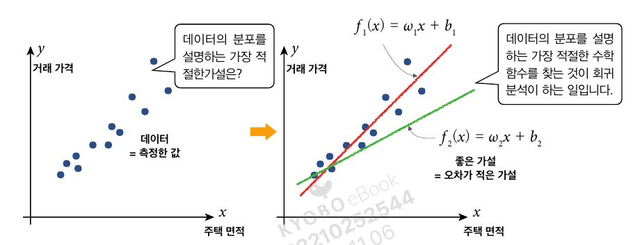
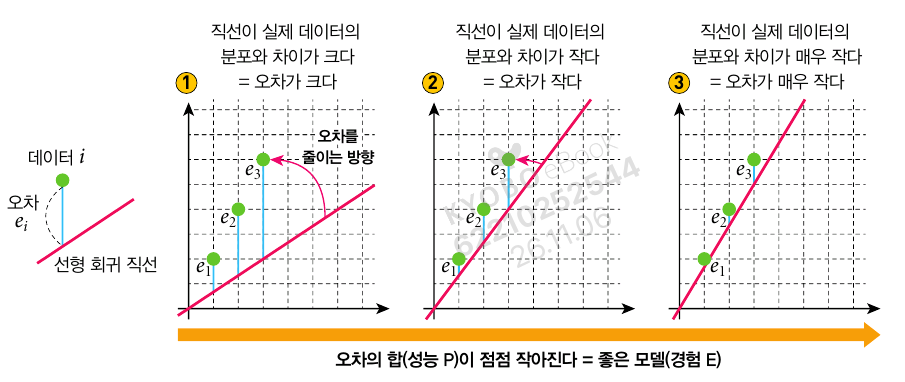
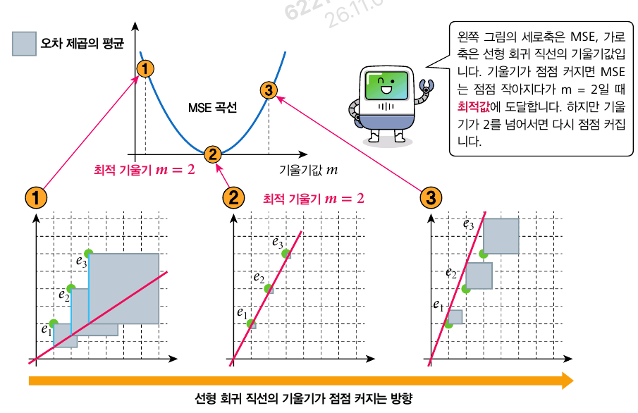
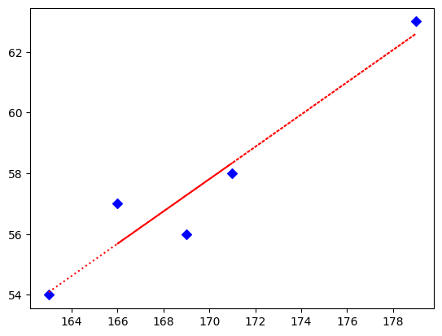
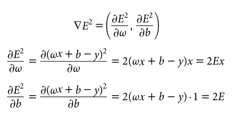
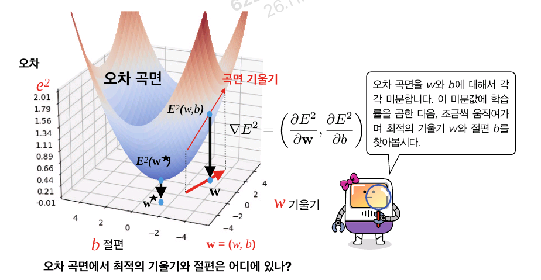

# 4. 선형 회귀와 경사하강법
## 4.1. 데이터의 특성과 선형회귀
- 특성: 관찰되는 현상에서 측정할 수 있는 개별적 속성
- 학습의 결과를 결정하는 데에 영향을 미치는 입력 데이터

### 회귀분석
- 회귀분석: 다차원 공간에 존재하는 데이터들을 가장 잘 설명하는 수학 함수를 찾는 것

- 가설
$$y = f(x)\\
f_1(x)=w_1x+b_1\\
f_2(x)=w_2x + b_2$$


- 좋은 가설: 오차가 작은 가설
    - 위 식에선 $f_2$가 더 좋은 가설

## 4.2. 오차와 오차의 측정
### 데이터의 분포와 경향성
- 선형회귀 직선: 데이터의 분포를 설명하는 직선
- 선형회귀 함수: 함수 $f(x)$를 설명하는 함수

### 데이터와 정답의 차이: 오차
- 오차: 예측한 값과 실제 값의 차이
$$e_i = |y_i - \hat{y}|$$


### MAE와 MSE
- MAE(Mean Absolute Error): 평균 절대 오차
$$MAE = \frac{1}{N} \sum_{i=1}^N |y_i-\hat{y}|$$
- 문제점
    - 미분 불가능 $\to$ 가중치 갱신 불가능해짐
    
- MSE(Mean Square Error): 평균 제곱 오차
$$MSE = \frac{1}{N} \sum_{i=1}^N (y_i-\hat{y})^2$$
- MSE의 이점: 오차가 크면 이 모델의 성능이 나쁘다는것을 알려줄 수 있음

- MAE와 MSE 비교
```python
# MAE
from sklearn.metrics import mean_absolute_error
import numpy as np

y = np.array([1, 2, 3, 4, 5])
y_hat = np.array([1.2, 2.4, 2.5, 4.6, 5.4])
diff = mean_absolute_error(y, y_hat)
print('MAE:', diff)
```
MAE: 0.41999999999999993

```python
# MSE
from sklearn.metrics import mean_squared_error

y = np.array([1, 2, 3, 4, 5])
y_hat = np.array([1.2, 2.4, 2.5, 4.6, 5.4])
diff = mean_squared_error(y, y_hat)
print('MSE:', diff)
```
MSE: 0.19399999999999995

### 선형 회귀 직선 구하기 예시

- 최적의 기울기는 M=2
- MSE 오차곡선: 평균 제곱 오차 값이 아랫쪽으로 볼록한 모양
    - 최적의 기울기는 MSE 오차곡선의 기울기가 0이되는 지점
    - $\to$ 최적의 기울기를 찾는 과정: **경사하강법(Gradient Descent)** 


## 4.4. 사이킷런 선형회귀

```python
# 라이브러리 임포트
import numpy as np
from sklearn.linear_model import LinearRegression

lr = LinearRegression()
x = [[163], [179], [166], [169], [171]]
y = [54, 63, 57, 56, 58]

lr.fit(x, y)

coef = lr.coef_ # 기울기
intercept = lr.intercept_ # 절편
score = lr.score(x, y) # 학습된 직선이 데이터를 얼마나 잘 따르는가?

print(f'y = {coef[0]:.2f}X + {intercept:.2f}')
print('score:', round(score, 3))
```
y = 0.53X + -32.50
score: 0.919

```python
# 시각화
import matplotlib.pyplot as plt

plt.scatter(x, y, color='blue', marker='D')
y_pred = lr.predict(x)
plt.plot(x, y_pred, 'r:')
plt.show()
```


### 오차 곡면
- 기울기 w와 절편 b에 대한 오차제곱 구하기




```python
X = np.array([1, 4.5, 9, 10, 13])
y = np.array([0, 0.2, 2.5, 5.4, 7.3])

w, b = 0, 0
learning_rate, epoch = 0.005, 1000
n = len(X)

for i in range(epoch):
    y_pred = w*X + b
    error = y_pred - y
    w -= learning_rate * (error * X).sum()
    b -= learning_rate * error.sum()

print(f'w: {w:.2f}, b: {b:.2f}')
```
w: 0.63, b: -1.65

- 학습률이 너무 작으면 진행속도가 너무 느리고, 너무 빠르면 발산해버림
```python
def grad(learning_rate, epoch):
    X = np.array([1, 4.5, 9, 10, 13])
    y = np.array([0, 0.2, 2.5, 5.4, 7.3])

    w, b = 0, 0

    n = len(X)

    for i in range(epoch):
        y_pred = w*X + b
        error = y_pred - y
        w -= learning_rate * (error * X).sum()
        b -= learning_rate * error.sum()

    return w, b

print('학습률이 너무 클 때')
w, b = grad(1.0, 1000)
print(f'w: {w}, b: {b}')

print('학습률이 너무 작을 때')
w, b = grad(1e-5, 1000)
print(f'w: {w:.2f}, b: {b:.2f}')
```
학습률이 너무 클 때
w: nan, b: nan
학습률이 너무 작을 때
w: 0.45, b: 0.03
/usr/local/lib/python3.13/dist-packages/numpy/_core/_methods.py:49: RuntimeWarning: overflow encountered in reduce
  return umr_sum(a, axis, dtype, out, keepdims, initial, where)
/tmp/ipykernel_55246/2550109307.py:12: RuntimeWarning: invalid value encountered in scalar subtract
  w -= learning_rate * (error * X).sum()

### 정규화와 표준화
- 정규화: 데이터의 값을 0에서 1 사이로 조정

$$\tilde{x}=\frac{x-x_{\min}}{x_{\max}-x_{\min}}$$

- 표준화: 평균이 0이고 표준편차가 1인 정규분포를 가지도록 데이터를 조정
$$x' = \frac{x-\mu_x}{\sigma_x}$$

```python
# 정규화
import numpy as np

yr = np.array([15, 30, 23, 5, 9, 43, 33, 29, 3, 56])
n_rooms = np.array([2, 4, 3, 4, 4, 3, 3, 1, 1, 2])

print(f'정규화 이전의 yr: {yr}')
sz = np.max(yr) - np.min(yr)
np.set_printoptions(precision=2) # 출력의 정밀도 설정
print(f'정규화 이후의 yr: {((yr - np.min(yr))/sz)}')

print(f'정규화 이전의 n_rooms: {n_rooms}')
sz = np.max(n_rooms) - np.min(n_rooms)
print(f'정규화 이후의 n_rooms: {((n_rooms - np.min(n_rooms))/sz)}')
```
정규화 이전의 yr: [15 30 23  5  9 43 33 29  3 56]\
정규화 이후의 yr: [0.23 0.51 0.38 0.04 0.11 0.75 0.57 0.49 0.   1.  ]\
정규화 이전의 n_rooms: [2 4 3 4 4 3 3 1 1 2]\
정규화 이후의 n_rooms: [0.33 1.   0.67 1.   1.   0.67 0.67 0.   0.   0.33]

```python
# 표준화
from sklearn.preprocessing import StandardScaler

scaler = StandardScaler()
# 표준화 데이터를 생성함
yr_scaled_d = scaler.fit_transform(yr[:, np.newaxis])
print(f'표준화 이전의 yr: {yr}')
np.set_printoptions(precision=2)
print(f'표준화 이후의 yr: {yr_scaled_d}')
```
표준화 이전의 yr: [15 30 23  5  9 43 33 29  3 56]\
표준화 이후의 yr: [[-0.59]
 [ 0.33]
 [-0.1 ]
 [-1.21]
 [-0.96]
 [ 1.13]
 [ 0.52]
 [ 0.27]
 [-1.33]
 [ 1.94]]