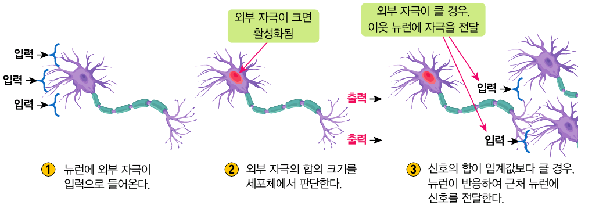
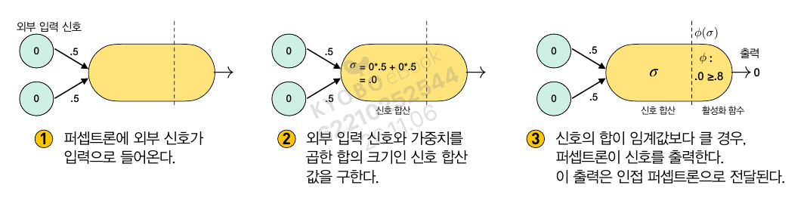
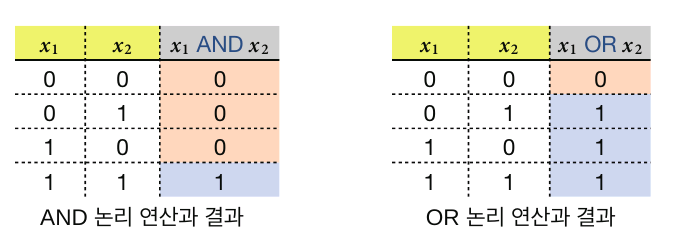
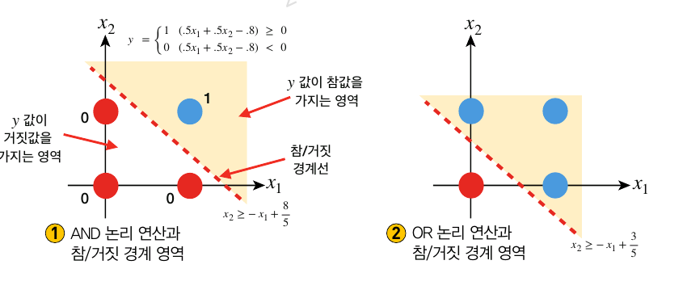
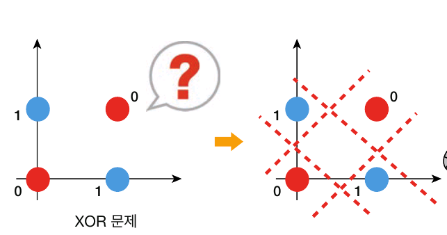
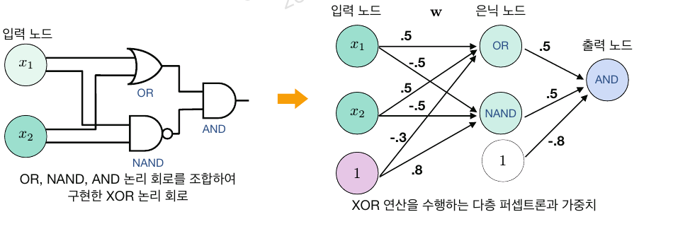
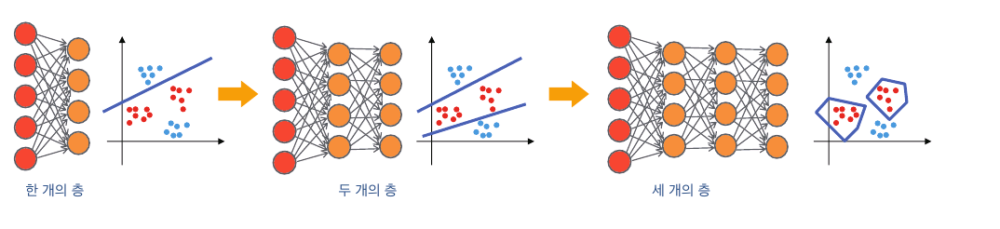
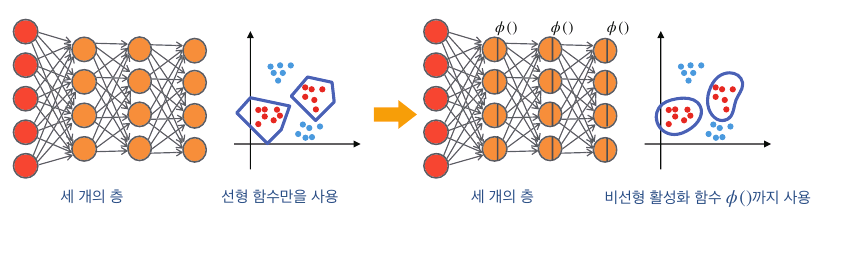

# 5. 신경세포와 퍼셉트론
## 5.1. 뇌와 신경세포 그리고 퍼셉트론
### 실제 뉴런과 인공신경망 비교


1. 외부 신호 입력
2. 외부 입력 신호와 가중치를 곱한 합의 크기인 신호 합산값 구함
3. 신호의 합이 임계값보다 크면 신호 출력. 이 신호는 인접 퍼셉트론으로 전달

### 퍼셉트론
- $\sum w_i x_i(\sigma)$: 신호 합산 값
- 신호 합산값이 활성화 함수 $\phi()$의 임계값을 넘으면 출력값 내보냄

$$X = \begin{bmatrix}
x_1   \\
x_2 
\end{bmatrix}\ 
W=\begin{bmatrix}
w_1   \\
w_2 
\end{bmatrix}\\
\sigma = \sum w_i x_i\\
output = \phi(\sigma)$$

- 예제
$$X = \begin{bmatrix}
1   \\
0 
\end{bmatrix}\ 
W=\begin{bmatrix}
0.5   \\
0.5 
\end{bmatrix}\\
\sigma = 1*0.5 + 0*0.5=0.5$$

## 5.2. 퍼셉트론의 표현 방법
### 행렬을 이용한 퍼셉트론 표현 방법
$$X = \begin{bmatrix}
1   \\
0 
\end{bmatrix}\ 
W=\begin{bmatrix}
0.5   \\
0.5 
\end{bmatrix}\\
\sigma = 1*0.5 + 0*0.5=0.5$$

```python
import numpy as np

X = np.array([1, 0])
W = np.array([0.5, 0.5])

print(np.sum(X*W)) # 성분의 합
print(np.dot(X, W)) # 위와 동일한 결과
```
0.5
0.5


### 신호의 전달 여부를 결정하는 임계값
- 활성화 함수(activate function): 인공신경망에서 각 퍼셉트론의 출력 값을 결정하는 함수
- 종류
    - sigmoid: $\sigma(x) = \frac{1}{e^x+1}$
    - ReLU: $ReLU(x)=\left\{\begin{matrix}
 x\ (x>0)\\0\ (else)
\end{matrix}\right.$
    - tanh, Leaky ReLU 등


### 계단함수를 사용한 신경망
$$\phi(\sigma)=\left\{\begin{matrix}
 1\ (\sigma \geq0.8)\\0\ (else)
\end{matrix}\right. $$
- $X = [0, 0]\to\ False \ (0+0=0)$ 
- $X = [0, 1]\to\ False \ (0+0.5=0.5)$
- $X=[1, 0]\to \ False \ (0.5+0=0.5)$
- $X=[1, 1]\to \ True \ (0.5+0.5=1)$

```python
# 계단함수를 사용한 신경망
import numpy as np

def and_gate(X):
    W = np.array([.5, .5])
    threshold = .8
    sigma = np.sum(X*W)
    if sigma >= threshold:
        return 1
    else: return 0

inputs = np.array([
    [0, 0], [0, 1], [1, 0], [1, 1]
])

for t in inputs:
    print(f't: {and_gate(t)}')
```
t: 0
t: 0
t: 0
t: 1

### OR 논리연산 퍼셉트론

- 임계값을 and 연산보다 작게 설정
$$\phi(\sigma)=\left\{\begin{matrix}
 1\ (\sigma \geq0.3)\\0\ (else)
\end{matrix}\right.$$
- $X = [0, 0]\to\ False \ (0+0=0)$ 
- $X = [0, 1]\to\ True \ (0+0.5=0.5)$
- $X=[1, 0]\to \ True \ (0.5+0=0.5)$
- $X=[1, 1]\to \ True \ (0.5+0.5=1)$

```python
# OR 신경망
def or_gate(X):
    W = np.array([.5, .5])
    threshold = .3
    sigma = np.sum(X*W)
    if sigma >= threshold:
        return 1
    else: return 0

inputs = np.array([
    [0, 0], [0, 1], [1, 0], [1, 1]
])

for t in inputs:
    print(f't: {or_gate(t)}')
```
t: 0
t: 1
t: 1
t: 1

### 편향값 추가
- 앞에서 쓴 0.3이나 0.8을 편향(bias)라 함
$$\phi(\sigma)=\left\{\begin{matrix}
1\ (if\ \sigma \geq 0)\\
0\ (else)
\end{matrix}\right.$$

```python
# 가중치를 활용한 논리 연산자
import numpy as np

# 활성화 여부
def activation(s):
    # 매개변수: 편향
    # 편향에 따른 계단함수 반환
    return 1 if s>=0 else 0

# 가중치 값에 따라 다른 값을 반환하는 논리연산자
def perceptron(X, W):
    # sigma가 임계값을 넘으면 1 반환
    # 그렇지 않으면 0 반환
    sigma = np.sum(X*W)
    return activation(sigma)

# and 함수
def AND(x):
    X = np.array([x[0], x[1], 1]) # x에 노드 1를 추가
    W = np.array([.5, .5, -.8])   # 가중치 값 설정하기
    return perceptron(X, W)

# or 함수
def OR(x):
    X = np.array([x[0], x[1], 1]) # X에 1 노드를 추가
    W = np.array([.5, .5, -.3])   # 가중치 값 설정하기
    return perceptron(X, W)

# nand 함수
def NAND(x):
    X = np.array([x[0], x[1], 1]) # X에 1 노드를 추가
    W = np.array([.5, .5, -.8])   # 가중치 값 설정하기
    return perceptron(X, -W)      # 가중치 W의 부호를 음수로 고침


inputs = np.array([[0, 0], [0, 1], [1, 0], [1, 1]])
print('AND 논리 연산')
for t in inputs:
    print(t, ':', AND(t))   # 입력값을 넘겨줌

inputs = np.array([[0, 0], [0, 1], [1, 0], [1, 1]])
print('OR 논리 연산')
for t in inputs:
    print(t, ':', OR(t))   # 입력값과 가중치를 넘겨줌

print('NAND 논리 연산')
for t in inputs:
    print(t, ':', NAND(t))   # 입력값과 가중치를 넘겨줌
```

AND 논리 연산
[0 0] : 0
[0 1] : 0
[1 0] : 0
[1 1] : 1
OR 논리 연산
[0 0] : 0
[0 1] : 1
[1 0] : 1
[1 1] : 1
NAND 논리 연산
[0 0] : 1
[0 1] : 1
[1 0] : 1
[1 1] : 0

## 5.3 XOR 문제와 다층 퍼셉트론
### 인공지능 연구으 침체기를 가져온 XOR  문제
- XOR 연산

$x_1$|$x_2$|$x_1 \oplus x_2$
---|---|---
0|0|0
0|1|1
1|0|1
1|1|0

- 선형 함수로는 XOR 연산 불가능
    - -> 다층 퍼셉트론으로 활용



### 은닉 노드를 가진 다층 퍼셉트론의 등장
- 퍼셉트론을 여러번 쓰면 비선형함수 없이도 XOR 연산 가능

$x_1$|$x_2$|$A = x_1 \wedge x_2$|$B = \neg (x_1\vee x_2)$|$A \vee B$
---|---|---|---|---
0|0|0|1|0
0|1|1|1|1
1|0|1|1|1
1|1|1|0|0

```python
# XOR 연산자

# 활성화 여부
def activation(s):
    # 매개변수: 편향
    # 편향에 따른 계단함수 반환
    return 1 if s>=0 else 0

# 가중치 값에 따라 다른 값을 반환하는 논리연산자
def perceptron(X, W):
    # sigma가 임계값을 넘으면 1 반환
    # 그렇지 않으면 0 반환
    sigma = np.sum(X*W)
    return activation(sigma)

def AND(x):
    X = np.array([x[0], x[1], 1]) # x에 노드 1를 추가
    W = np.array([.5, .5, -.8])   # 가중치 값 설정하기
    return perceptron(X, W)

def OR(x):
    X = np.array([x[0], x[1], 1]) # X에 1 노드를 추가
    W = np.array([.5, .5, -.3])   # 가중치 값 설정하기
    return perceptron(X, W)

def NAND(x):
    X = np.array([x[0], x[1], 1]) # X에 1 노드를 추가
    W = np.array([.5, .5, -.8])   # 가중치 값 설정하기
    return perceptron(X, -W)      # 가중치 W의 부호를 음수로 고침

def XOR(x):
    return AND([OR(x), NAND(x)])

print(' 다층 퍼셉트론으로 구현한 XOR 논리연산')
inputs = np.array([[0, 0], [0, 1], [1, 0], [1, 1]])
for t in inputs:
    print(f'{t}: {XOR(t)}')
```
 다층 퍼셉트론으로 구현한 XOR 논리연산
[0 0]: 0
[0 1]: 1
[1 0]: 1
[1 1]: 0

- 은닉 노드: 외부에서 드러나지 않는 연산 노드
    - 위 XOR 예제에선 OR 연산자와 NAND 연산자가 은닉노드에 해당

### 다층 퍼셉트론으로 해결할 수 있는 문제들
- 은닉층이 증가할수록 분류가 더욱 세분화
- 비선형 활성화 함수까지 쓰면 곡선 형태까지 사용 가능



