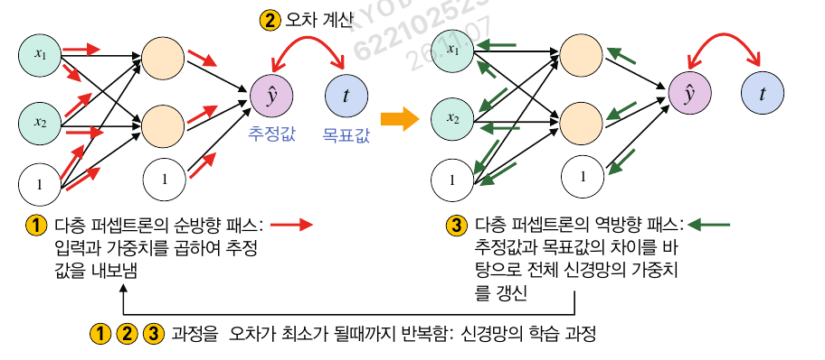
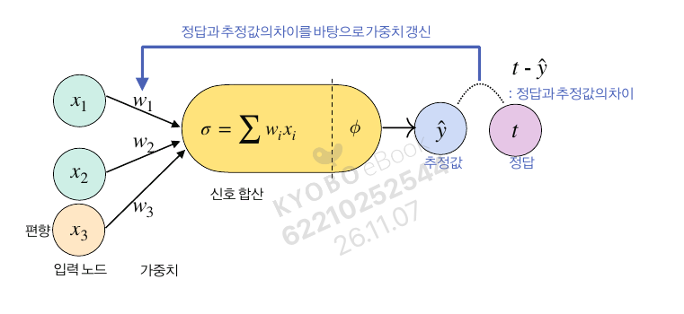
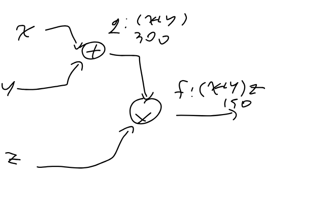
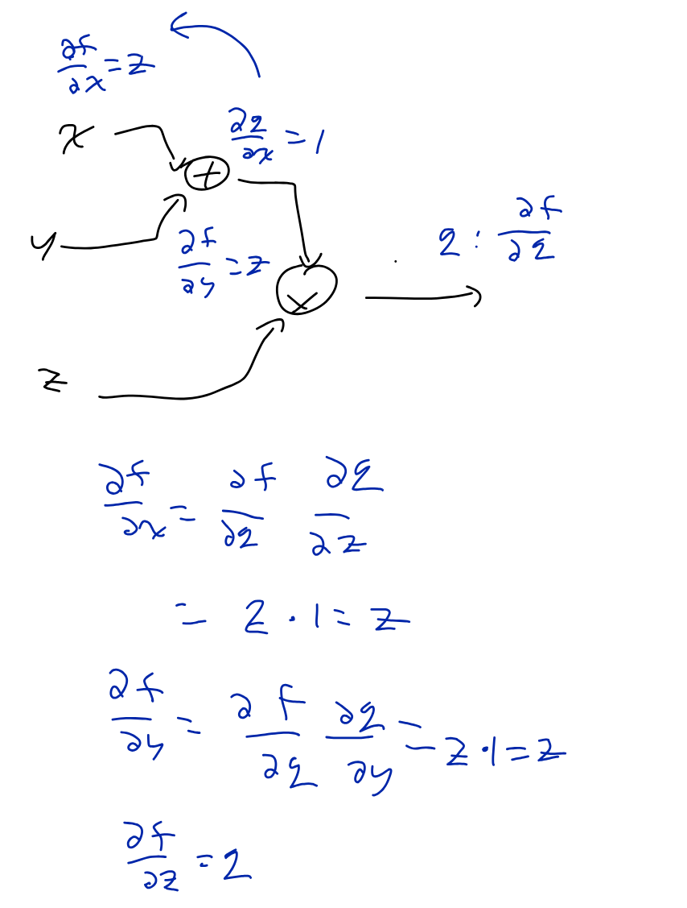
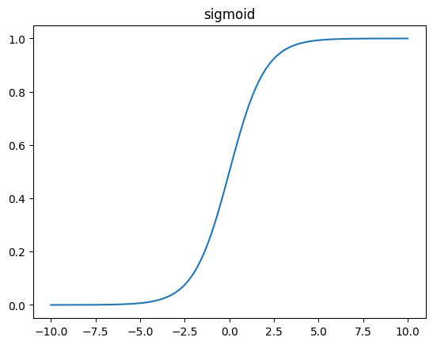
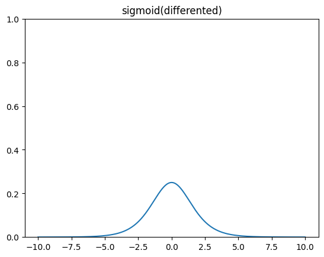
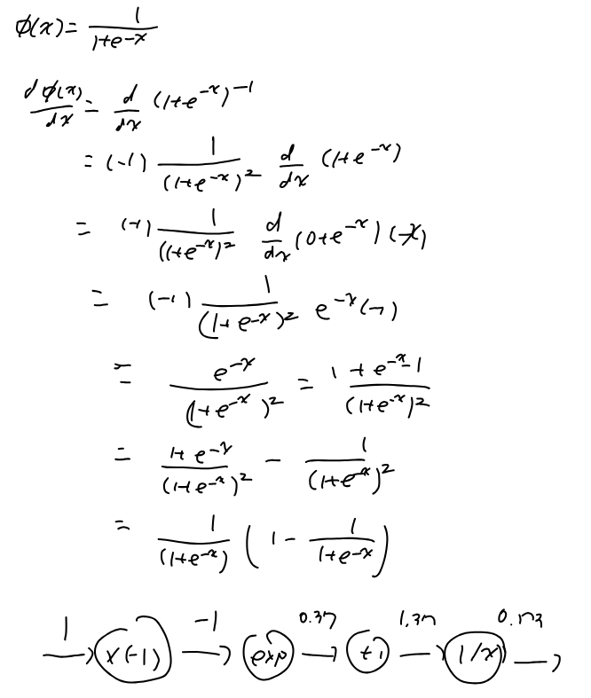

# 6. 오차 역전파
## 6.1. 활성화 함수와 신경망의 가중치 조절
### 다층 퍼셉트론의 학습 단계
> 1. 임의 초기 가중치를 가진 퍼셉트론에 입력 데이터 삽입
> 2. 입력값과 가중치를 이용하여 퍼셉트론의 노드 각각에 대한 가중합 계산
> 3. 노드 각각의 가중합 구하고 활성화 함수 입력으로 사용
> 4. 단계 2와 3을 출력 노드까지 반복
> 5. 출력 노드 값과 목표값 차이 구하기
> 6. 오차(출력노드와 목표값 차이)를 이전 퍼셉트론에 전달하여 가중치 수정
> 7. 수정된 가중치로 2~6 반복
> 8. 더 이상 학습이 이루어지지 않을 때까지 반복

- 이 단계를 위하여 각 층별 미분값과 활성화 함수 $\phi()$의 미분값을 구해야 함

표기법|의미
---|---
$E$|$(\hat{y}-y)$
$w$|가중치(오차가 최소가 되도록 갱신해야 함)
$\frac{\partial E}{\partial w}$|가중치에 대한 오차 변화율
$\phi$|활성화 함수
$\eta$|가중치 갱신을 위한 학습률

$$w \leftarrow w-\eta \cdot \frac{\partial E}{\partial w}$$

### 순전파와 역전파


1. $\hat{y}=wx+b$
2. $E=\hat{y}-y$
3. $w_{t+1}=w_t - \eta \cdot \frac{\partial E}{\partial w}$



## 6.2. 역전파 알고리즘에 대한 직관적 이해
### 계산 그래프의 순방향 계산
- $f(x, y, z)=(x+y)z$일 때, x=100, y=200, z=0.5를 주면


```python
x, y, z = 100, 200, 0.5

q = x+y; f = q*z
print(f'result of front propagation: q={q}, f={f}')
```
result of front propagation: q=300, f=150.0

### 계산 그래프의 역방향 계산

```python
dfdz = q
dfdq = z
dqdx = 1.0
dqdy = 1.0

dfdx = dfdq * dqdx
dfdy = dfdq * dqdy

print(f'df/df={dfdx}, df/dy={dfdy}, df/dz={dfdz}')
```
df/df=0.5, df/dy=0.5, df/dz=300

## 6.4. 시그모이드 계층의 역전파
- 시그모이드 함수
$$phi(x)=\frac{1}{1+e^{-x}}\\
\frac{d\phi(x)}{dx}=\frac{1}{1+e^{-x}}(1-\frac{1}{1+e^{-x}})$$





### 시그모이드 함수의 미분과 계산 그래프

```python
import math

n0 = 1.0
n1 = n0 * -1.0
n2 = math.e ** (n1)
n3 = n2+1
n4 = 1/n3

print(f'{n0}, {n1}, {n2:.3f}, {n3:.3f}, {n4:.3f}')
```
1.0, -1.0, 0.368, 1.368, 0.731

## 6.5. ReLU 함수
### 활성화함수의 역할
- 비선형성 추가
- 복잡한 결정 경계 생성: 임계값 역할 
- 역전파를 위한 오차의 기울기 제공: 미분을 가능하게 함으로써가중치 업데이트를 할 수 있게 함
### 시그모이드 함수의 문제점
- 기울기 소실 문제: 출력이 0 또는 1에 가까워질수록 기울기가 0으로 수렴
- 계산비용: 지수함수를 사용해서 정수보다 연산량이 훨씬 많음
    - 부동 소수점
- 출력이 0에서 1 사이로 한정됨: 신경망의 출력은 항상 양수임 -> 학습의 어려움


```python
#시그모이드 함수의 기울기 소실
import numpy as np
import matplotlib.pyplot as plt

def sigmoid(x):
    return 1 / (1 + np.exp(-x))


for x in range(-2, 3):
    print(f'sigmoid{x}: {sigmoid(x)}')
```
sigmoid-2: 0.11920292202211755\
sigmoid-1: 0.2689414213699951\
sigmoid0: 0.5\
sigmoid1: 0.7310585786300049\
sigmoid2: 0.8807970779778823

### ReLU 함수
$$ReLU(x)=
\left\{\begin{matrix}
x\ (x\geq 0) \\
0\ (else)
\end{matrix}\right.$$
- 기울기 소실 문제 감소: 양수 입력에는 기울기가 1이므로 기울기 소실 문제 해결
- 계산 효율성: 0 이하면 0, 그 이상이면 입력값 그대로 출력 -> 계산 단순


```python
# ReLU funciton
def ReLU(x):
    return np.maximum(0, x)

for x in range(-2, 3):
    print(f'relu({x}): {ReLU(x)}')
```
relu(-2): 0
relu(-1): 0
relu(0): 0
relu(1): 1
relu(2): 2