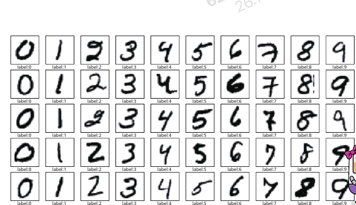
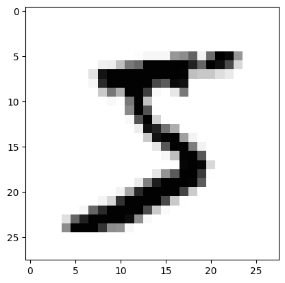
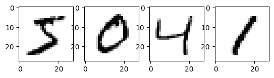
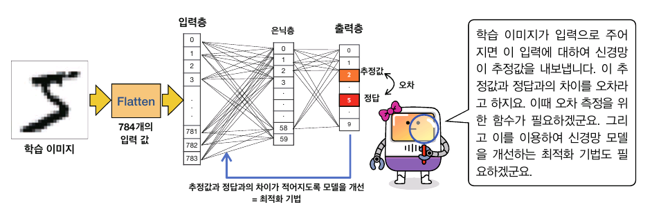
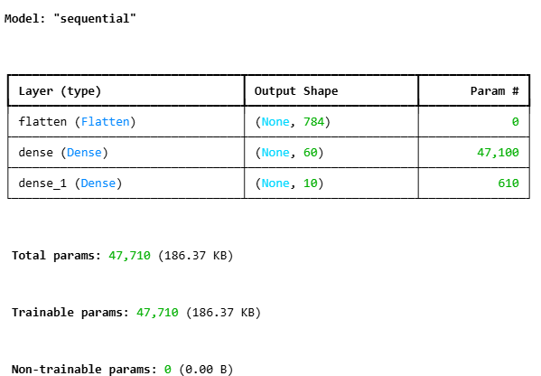
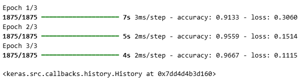

# 7. 텐서플로로 구현하는 딥러닝
## 1. 딥러닝을 위한 도구: 텐서플로우
### 텐서플로우와 MNIST 데이터
- 특징
    - GPU 자동 사용
    - 자동 미분 기능 제공
    - 모튤화된 구성 요소 제공
    - GPU 지원과 높은 확장성 제공

- MNIST 데이터: 28x28 크기의 회색조 손글씨 숫자 데이터

#### MNIST 데이터 불러오고 확인하기

```python
import tensorflow as tf
from tensorflow import keras
import numpy as np
import matplotlib.pyplot as plt

# MNIST 데이터 불러오기
mnist = keras.datasets.mnist
(train_images, train_labels), (test_images, test_labels) = \
mnist.load_data()
```

```python
# 이미지 크기
print('train images/labels and test images/labels size')
print(train_images.shape, train_labels.shape,\
      test_images.shape, test_labels.shape)
```
train images/labels and test images/labels size\
(60000, 28, 28) (60000,) (10000, 28, 28) (10000,)

- MNIST의 훈련 데이터는 60000개, 테스트 데이터는 10000개
    - 이미지는 28x28 크기, 레이블은 스칼라값

#### MNIST 이미지 조회하기
```python
# 이미지 출력
num = train_images[0] # 첫 번째 데이터
plt.imshow(num, cmap='Greys')
```


```python
# 이미지 여러장 출력
fig = plt.figure()

for i in range(1, 5):
    ax = fig.add_subplot(1, 4, i)
    ax.imshow(train_images[i-1], cmap='Greys')
```


### 딥러닝의 이미지 처리 방법



## 7.2. 딥러닝 모델 만들고 학습시키기
### 학습 단계
1. 학습 이미지 전처리
2. 신경망 모델 정의
3. 활성화함수, 학습을 위한 최적화 함수, 손실함수, 측정 방법 정의
4. 학습
5. 정확도 측정
6. 성능 개선

### 데이터 전처리
- MNIST 데이터는 0~255의 값으로 구성
- 회색조 이미지를 0~1 사이의 값으로 전처리
```python
# 입력값 전처리
train_images, test_images = train_images/255, test_images/255
```

### 신경망 모델 만들기
- 입력층 - 은닉층 - 출력층의 순차적 연결 구조를 가지는 신경망 모델
- 입력으로 1차원 배열 사용
    - Flatten 클래스 사용하여 2차원 배열을 1차원 배열로 평탄화
    - 예제에선 784(=28x28) 크기의 입력이 사용됨
- 완전 연결(Dense, Full connected)
    - 입력은 압 층에서 주어짐
    - 60개의 노드 (-> 784x60=47040개의 네트워크)
    - 실제론 편향노드 하나가 추가되어 61개의 노드
    - 경사하강법을 이용하여 오차 줄이는 방법으로 학습, 오차역전파를 이용하여 가장 좋은 가중치와 편향값 찾아나감

```python
# 신경망 모델 만들기
model = keras.Sequential([
    keras.layers.Flatten(input_shape=(28, 28)),
    keras.layers.Dense(60, activation='relu'),
    keras.layers.Dense(10, activation='softmax')
])
model.summary()
```


### 인공신경망 학습
- 최적화(optimization): 모델을 점점 더 좋은 상태로 만드는 것
    - 예제에선 adam 기법을 사용
- 손실함수: 오차를 측정
    - 예제에선 sparse_categorical_crossentropy()를 사용
- 평가 방법으로 accuracy 사용

```python
model.compile(optimizer='adam',
              loss='sparse_categorical_crossentropy',
              metrics=['accuracy'])
```

#### 데이터로 모델 학습
- epoch이 진행되면서 loss가 감소, accuracy가 증가하는 방향으로 학습됨
- 배치: 학습 데이터의 단위
    - 데이터가 너무 크면 많은 메모리 필요
    - 메모리를 아끼기 위해 배치로 데이터 분할(예제에선 32개의 이미지를 묶어서 학습)
- 한 학습 당(1에폭 당) 47000개 이상의 파라미터가 갱신됨
```python
model.fit(train_images, train_labels, epochs=3)
```


### 모델 정확도 알아보기
```python
test_loss, test_acc = model.evaluate(test_images, test_labels, verbose=2)
print('테스트 정확도:', test_acc)
```
313/313 - 2s - 7ms/step - accuracy: 0.9676 - loss: 0.1032\
테스트 정확도: 0.9675999879837036

## 7.4. 신경망 학습의 출력값과 정답의 차이를 알아보자
### 소프트맥스 함수
- 소프트맥스 함수: 예측값을 가진 벡터를 0에서 1 사이의 클래스별 확률값으로 변환

$$\sigma(z)_i=\frac{e^{z_i}}{\sum_{j=1}^k e^{z_i}}$$
- $i\in [1, K]$이고, $z[z_1, z_k]\in \mathbb{R}$

```python
import numpy as np

def softmax(a):
    e_a = np.exp(a)
    sum_e = np.sum(e_a)
    y = e_a / sum_e
    return y

a = np.array([0.5, 4.1, 2.5, 5.6, 1.2])
print('예측값:', a)
print('소프트맥스 함수의 출력:', softmax(a))
```
예측값: [0.5 4.1 2.5 5.6 1.2]\
소프트맥스 함수의 출력: [0.00473882 0.17343248 0.03501541 0.77727047 0.00954281]

### 원-핫 인코딩과 범주형 데이터의 평균 제곱 오차
- 원-핫 인코딩: 범주형 데이터를 이진수 벡터로 사상
    - [0, 1, 2, 3, 4]의 카테고리 값을 [1, 0, 0, 0, 0], [0, 1, 0, 0, 0], ...으로 사상

```python
# 원-핫 인코딩
import numpy as np
from keras.utils import to_categorical

data = np.array([0, 1, 2, 3, 4])
print('원본:', data)

encoded = to_categorical(data)
print('원-핫 인코딩된 데이터')
print(encoded)
```
원본: [0 1 2 3 4]\
원-핫 인코딩된 데이터\
[[1. 0. 0. 0. 0.]\
 [0. 1. 0. 0. 0.]\
 [0. 0. 1. 0. 0.]\
 [0. 0. 0. 1. 0.]\
 [0. 0. 0. 0. 1.]]

#### 평균제곱오차
$$E_{mse}=\frac{1}{m}\sum_{i=1}^m (\hat{y_i}-y_i)^2$$

### 교차 엔트로피
- 교차 엔트로피 오차(CrossEntropy Error): 분류 모델의 정답값이 원-핫 인코딩으로 구성될 때 사용하는 오차 함수
- $$CEE=-\sum t \log(y+\delta)$$