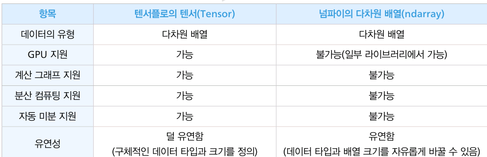

# 8. 텐서와 딥러닝 응용
## 8.1 텐서를 알아보자

### 인공지능의 부흥, 고성능 하드웨어 기술, 그리고 텐서플로우
#### 인공지능 부흥 원인
1. 데이터 증가
2. 인공지능 알고리즘 발전
3. GPU 등 하드웨어 발전

####  GPU
- GPU는 여러 개의 핵심 연산장치가 동시에 작동
    - 데이터를 병렬적으로 처리해야만 모니터와 같은 출력 장치에서 실시간으로 화면을 보여줄 수 있음

### 텐서의 개념
- 텐서(Tensor): 다차원 배열
    - 텐서플로의 텐서는 텐서플로 라이브러리에 다루는 GPU를 사용하는 행렬 자료형을 의미

#### 차원별 텐서 유형
- 스칼라: 0차원
- 벡터: 1차원
- 행렬: 2차원
- 이미지: 3차원(너비, 높이, 색상(rgb))
- 동영상: 4차원(너비, 높이, 색상, 시간)

#### 텐서와 넘파이의 차이점


### 텐서플로 라이브러리

```python
import tensorflow as tf

print(tf.math.add(1, 2))
print(tf.math.add([1, 2], [3, 4]))
```

```
tf.Tensor(3, shape=(), dtype=int32)
tf.Tensor([4 6], shape=(2,), dtype=int32)
```